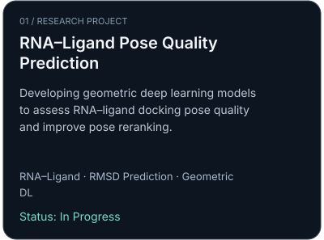
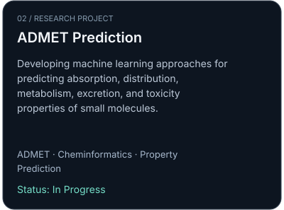
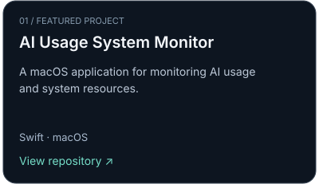
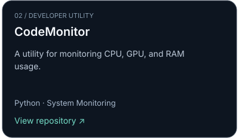
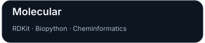
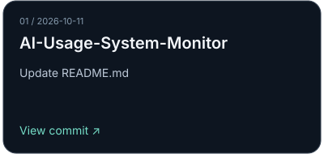
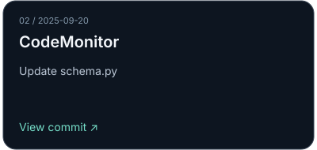

<!-- Generated file. Edit README.template.md and data/*.yaml instead. -->

<h1 align="center">AI for Molecular Discovery</h1>

<strong>Computational Biology · Deep Learning · Drug Discovery</strong>

Building AI models to understand molecular interactions and predict molecular properties.

<code>RNA–Ligand Interactions</code> &nbsp;·&nbsp; <code>Molecular Property Prediction</code> &nbsp;·&nbsp; <code>Geometric Deep Learning</code> &nbsp;·&nbsp; <code>AI for Drug Discovery</code>

---
## Research

<em>Exploring computational methods for drug discovery and molecular understanding</em>

---
## The Build Lab

*Ideas → Working Software*

<a href="https://github.com/gn1793?tab=repositories">Explore All Projects →</a>

---
## Tools & Technologies

---
## GitHub Stats

  

---
## Recent Activity

*Latest public updates across tracked projects*

