<!-- Generated automatically. Update README.template.md and data/*.yaml. -->

<h1 align="center">AI for Molecular Discovery</h1>

<strong>Computational Biology · Deep Learning · Drug Discovery</strong>

## Research Interests
<table><tr>
<td width="25%" align="center">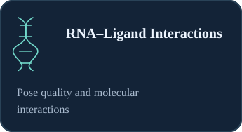</td><td width="25%" align="center">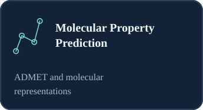</td><td width="25%" align="center">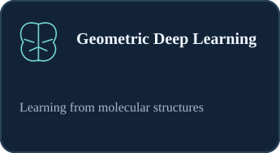</td><td width="25%" align="center">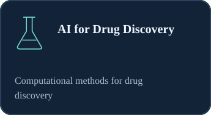</td></tr></table>

## Featured Research
<table><tr>
<td width="50%" valign="top">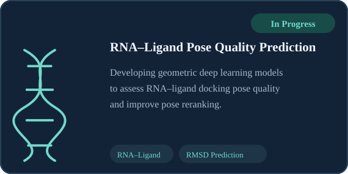</td><td width="50%" valign="top">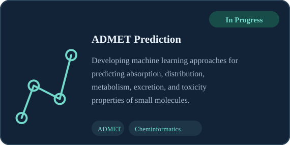</td></tr></table>

## The Build Lab
*Turning ideas into working software, one project at a time.*

<strong>Build Archive · 1 released projects</strong>

<a href="https://github.com/gn1793/CodeMonitor">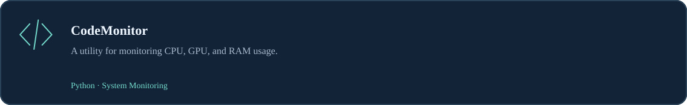</a>

## Technical Stack
<table><tr>
<td width="20%" valign="top" align="center">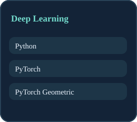</td><td width="20%" valign="top" align="center">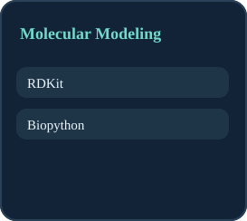</td><td width="20%" valign="top" align="center">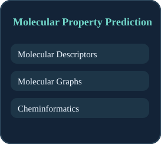</td><td width="20%" valign="top" align="center">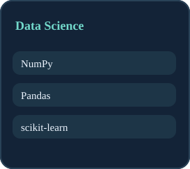</td><td width="20%" valign="top" align="center">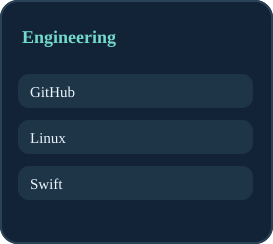</td></tr></table>

## Publications
> Research outputs and publications will be listed here as they become publicly available.

## Recent Development Activity
- **[gn1793/AI-Usage-System-Monitor](https://github.com/gn1793/AI-Usage-System-Monitor)** — [Update README\.md](https://github.com/gn1793/AI-Usage-System-Monitor/commit/1c881634b03da79391da09aae86c08ddfa3c564f) · 2026-10-11
- **[gn1793/AI-Usage-System-Monitor](https://github.com/gn1793/AI-Usage-System-Monitor)** — [Add AI Usage System Monitor app](https://github.com/gn1793/AI-Usage-System-Monitor/commit/abbe8859f254e3d6184d48a2bada748c9fdf0dd3) · 2026-10-11
- **[gn1793/AI-Usage-System-Monitor](https://github.com/gn1793/AI-Usage-System-Monitor)** — [Initial commit](https://github.com/gn1793/AI-Usage-System-Monitor/commit/4cb75604e320f4b86c53861d9d26448e88d0e5eb) · 2026-10-11
- **[gn1793/CodeMonitor](https://github.com/gn1793/CodeMonitor)** — [Update schema\.py](https://github.com/gn1793/CodeMonitor/commit/6802d30506fbbb3cf147ee01f6c83ffa5d9f58ae) · 2025-09-20
- **[gn1793/CodeMonitor](https://github.com/gn1793/CodeMonitor)** — [Update README\.md](https://github.com/gn1793/CodeMonitor/commit/ef361ee0201ec44dd4a7f4cff0d5f1f2b7e3e810) · 2025-09-20
