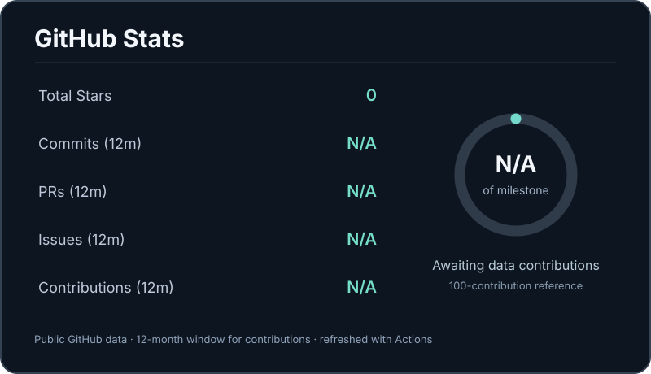

<!-- Generated file. Edit README.template.md and data/*.yaml instead. -->

<h1 align="center">AI for Molecular Discovery</h1>

<strong>Computational Biology · Deep Learning · Drug Discovery</strong>

Building AI models to understand molecular interactions and predict molecular properties.

<code>RNA–Ligand Interactions</code> &nbsp;·&nbsp; <code>Molecular Property Prediction</code> &nbsp;·&nbsp; <code>Geometric Deep Learning</code> &nbsp;·&nbsp; <code>AI for Drug Discovery</code>

---
## Featured Research

<table width="100%">
<tr>
<td width="50%" valign="top">
01 / STRUCTURE-BASED DRUG DISCOVERY
<h3>RNA–Ligand Pose Quality Prediction</h3>

Developing geometric deep learning models to assess RNA–ligand docking pose quality and improve pose reranking.

<code>RNA–Ligand</code> <code>RMSD Prediction</code> <code>Geometric DL</code> 

Status: In Progress

</td>
<td width="50%" valign="top">
02 / MOLECULAR PROPERTY PREDICTION
<h3>ADMET Prediction</h3>

Developing machine learning approaches for predicting absorption, distribution, metabolism, excretion, and toxicity properties of small molecules.

<code>ADMET</code> <code>Cheminformatics</code> <code>Property Prediction</code> 

Status: In Progress

</td>
</tr>
</table>

---
## The Build Lab

*Ideas → Working Software*

<table width="100%">
<tr>
<td width="50%" valign="top">
01 / FEATURED PROJECT
<h3><a href="https://github.com/gn1793/AI-Usage-System-Monitor">AI Usage System Monitor</a></h3>

A macOS application for monitoring AI usage and system resources.

<code>Swift</code> <code>macOS</code> 

<a href="https://github.com/gn1793/AI-Usage-System-Monitor">View repository ↗</a>

</td>
<td width="50%" valign="top">
02 / DEVELOPER UTILITY
<h3><a href="https://github.com/gn1793/CodeMonitor">CodeMonitor</a></h3>

A utility for monitoring CPU, GPU, and RAM usage.

<code>Python</code> <code>System Monitoring</code> 

<a href="https://github.com/gn1793/CodeMonitor">View repository ↗</a>

</td>
</tr>
</table>

<a href="https://github.com/gn1793?tab=repositories">Explore All Projects →</a>

---
## Tools & Technologies

| Category | Technologies |
| :--- | :--- |
| **Languages** | `Python` · `Swift` |
| **Deep Learning** | `PyTorch` · `PyTorch Geometric` |
| **Molecular** | `RDKit` · `Biopython` · `Cheminformatics` |
| **Engineering** | `GitHub` · `Linux` |

---
## GitHub Stats

  

---
## Recent Activity

*Latest public updates across tracked projects*

<table width="100%">
<tr><th align="left">Repository</th><th align="left">Update</th><th align="right">Date</th></tr>
<tr><td><a href="https://github.com/gn1793/AI-Usage-System-Monitor">AI-Usage-System-Monitor</a></td><td><a href="https://github.com/gn1793/AI-Usage-System-Monitor/commit/1c881634b03da79391da09aae86c08ddfa3c564f">Update README.md ↗</a></td><td align="right"><code>2026-10-11</code></td></tr>
<tr><td><a href="https://github.com/gn1793/CodeMonitor">CodeMonitor</a></td><td><a href="https://github.com/gn1793/CodeMonitor/commit/6802d30506fbbb3cf147ee01f6c83ffa5d9f58ae">Update schema.py ↗</a></td><td align="right"><code>2025-09-20</code></td></tr>
</table>
