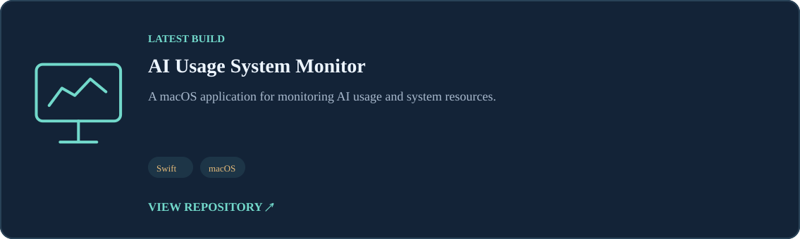

<!-- Generated automatically. Update README.template.md and data/*.yaml. -->

<h1 align="center">{{ profile.headline | e }}</h1>

<strong>{{ profile.tagline | e }}</strong>

## Research Interests
<table><tr>
<td width="25%" align="center"></td>
</tr></table>

## Featured Research
<table><tr>
<td width="50%" valign="top"> <a href="https://github.com/{{ project.repository | e }}">Research repository ↗</a></td>
</tr></table>

## The Build Lab
*Turning ideas into working software, one project at a time.*







<strong>Build Archive · {{ archive_builds | length }} released projects</strong>







## Technical Stack
<table><tr>
<td width="20%" valign="top" align="center"></td>
</tr></table>

## Publications


- **{{ paper.title | md_text }}** ({{ paper.year }}) — {{ paper.venue | md_text }} · [DOI](https://doi.org/{{ paper.doi }}) · [arXiv](https://arxiv.org/abs/{{ paper.arxiv }})


> Research outputs and publications will be listed here as they become publicly available.


## Recent Development Activity


- **[{{ event.repo | md_text }}](https://github.com/{{ event.repo }})** — [{{ event.message | md_text }}]({{ event.url }}) · {{ event.date }}


Recent public repository updates will appear after the first successful GitHub Actions synchronization.

